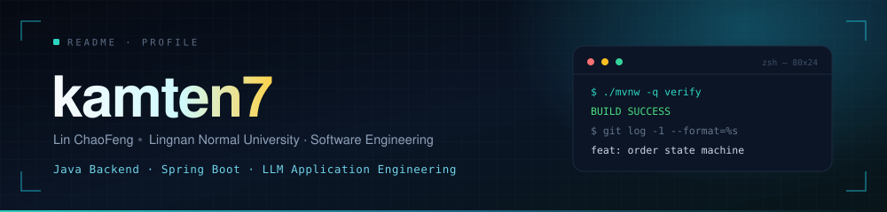
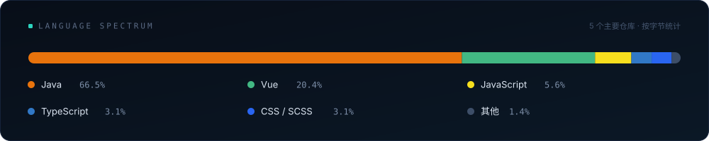
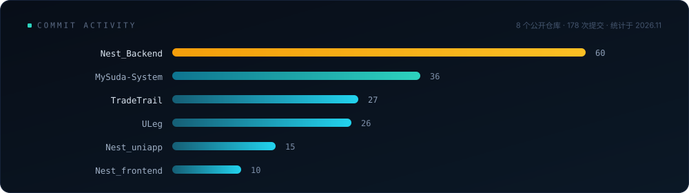
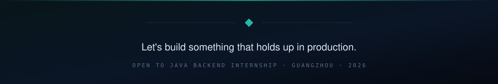

 

---

## 现在 / Now

- **主项目 [Nest_Backend](https://github.com/kamten7/Nest_Backend)** —— 租房平台后端。最近在收两件事：把「先查再改」的地方换成带条件的更新，把散在 Service 里的状态判断收拢成一处。
- **新项目 [TradeTrail](https://github.com/kamten7/TradeTrail)** —— 商城交易闭环。订单状态机 + 库存预留、支付回调幂等、物流签名推送与失败重试，7 个 Maven 模块，带 CI 和 Docker Compose。
- **在补** Java 八股（JVM / 并发 / MySQL / Redis）和算法 Hot 100，标准是「不看稿能讲清楚」，而不是「刷过」。
- **找工作** 2026 年 12 月起投，广州，Java 后端实习。

## 关于我 / About

林潮锋，岭南师范学院软件工程大三。写 Java 后端，也把大模型接进 JVM 里——用 LangChain4j 做 Function Calling、会话记忆和 SSE 流式输出，把模型能力封装成普通、可测试的 Service。

我不太相信「功能跑通了就算完成」。更在意的是：异常路径能不能复现、数据会不会写脏、下一个人改不改得动。所以顺序通常是——先想清楚状态怎么流转，再设计表，最后才是接口和单测。

> *Backend engineering is mostly about the unhappy paths.*

## 精选项目 / Selected work

### 🏠 Nest_Backend — 租房平台后端

`Java 21` `Spring Boot 3.4` `MyBatis-Plus` `MySQL` `Redis` `LangChain4j`

**8 个 Maven 模块** · **19 张业务表** · **110 个单元测试**

- **按业务域拆模块**：`nest-order` / `nest-wallet` / `nest-ai` / `nest-common` 各自独立打包，模块依赖方向就是约束，避免 Service 之间互相调成一团。
- **一处收口的基础设施**：JWT 鉴权、全局异常、参数校验、MinIO 文件存储统一在 `nest-common`，业务代码里不再出现 try-catch 兜底。
- **大模型当普通接口用**：LangChain4j 注册 5 个 `@Tool` 查房源、算价格，SSE 三回调推流，Redis 存多轮会话记忆；对前端来说它仍是一个普通 HTTP 接口。

### 📦 TradeTrail — 商城交易闭环

`Java 21` `Spring Boot 3.5` `MySQL 8.4` `Vue 3` `Maven ×7`

**7 个 Maven 模块** · **3 个操作入口**（商城 / 管理台 / 物流模拟端）· **CI + Docker Compose**

- **订单状态机 + 库存预留**：下单「可售 → 预留」、支付「预留 → 已售」、退款「已售 → 回补」，每一步都是带条件的状态转换，而不是改一个状态字段。库存不足整体回滚，未付款超时释放预留。
- **幂等与失败恢复**：支付渠道记录与金额双重校验，重复通知不重复确认；失败任务可以在管理台重放，不用手工改库。
- **物流是独立服务**：自己的库、自己的轨迹，只通过签名 HTTP 向商城推送事件——用一个小场景把「跨服务不一致怎么兜」讲完。

### 🤝 anxin-backend — 合同风险分析 （3 人团队，我负责文档解析 / OCR / 风险分析三个模块）

`Spring Boot` `Apache Tika` `PP-OCR` `LangChain4j`

打通「文档解析 → 条款切分 → 大模型风险分析」：Tika 抽全文，纯 Java 在 JVM 里跑 PP-OCR（不依赖 Python 环境），模型输出用围栏解析 + 失败降级，坏输出不会直接透给前端。

### 📱 Nest_uniapp / Nest_frontend — 用户端与房东端

[Nest_uniapp](https://github.com/kamten7/Nest_uniapp) 微信小程序：登录鉴权、房源检索、地图定位、在线预订，封装统一请求拦截与 Vuex 状态管理。 
[Nest_frontend](https://github.com/kamten7/Nest_frontend) 房东管理台：房源上架、订单处理、数据看板（Vue 3 + TypeScript + Vite）。

## 技术栈 / Stack

- **主力** Java 21 · Spring Boot 3 · Spring MVC · MyBatis-Plus · Maven 多模块
- **数据** MySQL（表设计 / 索引 / 慢查询）· Redis（缓存 / 会话）
- **大模型应用** LangChain4j · Function Calling · SSE 流式 · 结构化输出与容错
- **前端够用** Vue 3 · TypeScript · uni-app

## 数据 / Numbers

## 我写后端时的四条准则 / How I work

1. **先画状态，再写代码。** 一个实体有几种状态、谁能改、改了要不要留痕——这三问答不上来，就别急着写 Service。
2. **先想失败，再想成功。** 超时、重复回调、并发改同一行，这些路径不写清楚，功能就只是「演示能跑」。
3. **能测的地方必须有测试。** 单测覆盖业务规则，不覆盖 getter。
4. **不为简历堆技术。** 用不上的中间件，不如把事务边界和索引讲明白。

## 联系 / Contact

 

 

头图、两张数据图、页脚都是仓库内自绘的 SVG（`assets/`），不依赖第三方卡片服务，国内网络打开也不会挂图。
